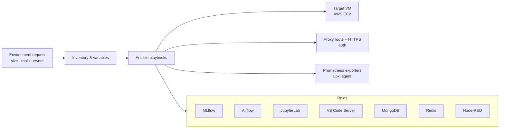

# Developer & Data Science Environment Automation

 -lightgrey) 

> **Architecture write-up.** This documents a system I designed and built as a DevOps Engineer at Faclon Labs (Mumbai). The implementation belongs to my employer and is not published; what follows is the design, the moving parts and the outcomes, with internal names and details left out.

Complete development and data-science environments — MLflow, Airflow,
JupyterLab, VS Code Server, MongoDB, Redis, Node-RED — provisioned by Ansible
in minutes instead of being assembled by hand over hours or days.

## The problem

A data scientist's environment was a list of tools installed one by one, each
with its own config, ports, users and TLS. Setups differed from person to
person, and rebuilding one after a failure was as slow as the first time.

## Architecture

## How it works

1. A request becomes a few variables: which tools, how big, who owns it.
2. Playbooks apply one role per tool — packages, users, config, systemd
   units, data directories, versions pinned.
3. The same run registers the HTTPS route and authentication on the central
   proxy and installs the monitoring and logging agents, so the environment is
   observable from the first minute.
4. Re-running is safe: roles are idempotent, so an update or a repair is the
   same command as a build.

## Design points

- **Everything is a role**, so a new tool is one more role, not a new procedure.
- **No snowflakes**: two environments requested the same way are the same.
- **Observability and access are part of provisioning**, not follow-up tasks.

## Outcomes

- Environment setup from **hours / days to minutes**.
- Consistent, reproducible environments for 60–70 developers and data scientists.
- Rebuilds and upgrades became routine.

## Stack

Ansible · AWS EC2 · MLflow · Airflow · JupyterLab · VS Code Server · MongoDB · Redis · Node-RED · Nginx / HAProxy · Prometheus · Loki

## My role

Wrote the playbooks and roles, defined the environment model and rolled it
out across the team.
