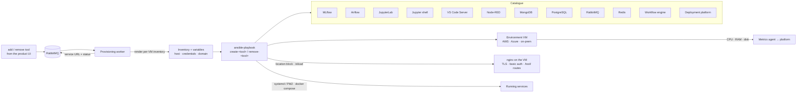

# Developer & Data Science Environment Automation

 -lightgrey) 

> **Architecture write-up.** This documents a system I designed and built as a DevOps Engineer at Faclon Labs (Mumbai). The implementation belongs to my employer and is not published; what follows is the design, the moving parts and the outcomes, with internal names and details left out.

Complete development and data-science environments provisioned by Ansible in
minutes instead of being assembled by hand over hours or days. The playbooks
are the **tool catalogue of the compute provisioner** (see that write-up):
when a user adds a tool to their environment, a worker renders an inventory
for that machine and runs the tool's install playbook; removing it runs the
matching remove playbook. **12 tools** today — MLflow, Airflow, JupyterLab, a
Jupyter shell, VS Code Server, Node-RED, MongoDB, PostgreSQL, RabbitMQ, Redis,
a workflow engine and the internal deployment platform — each reachable on the
environment's own domain behind TLS and authentication. The same model serves
**60–70 engineers** and the product's own users.

## The problem

A data scientist's environment was a list of tools installed one by one, each
with its own config, ports, users and TLS. Setups differed from person to
person, rebuilding one after a failure was as slow as the first time, and
nobody could add a tool to a running environment without an operator.

## Architecture

## How it works

1. A tool request arrives as a message with the environment id and the tool.
2. The worker writes an inventory for that one machine — host, key, the
   environment's domain and credentials — and runs the tool's playbook.
3. The playbook installs the tool (packages, a virtual environment or a
   container, data directories, pinned versions), starts it under systemd,
   PM2 or docker compose, adds its nginx location block under the environment's
   domain with basic authentication, and reloads nginx.
4. The worker publishes the tool's URL and status back; the UI shows it live.
5. Remove playbooks reverse the install cleanly. Re-running is safe: tasks are
   idempotent, so an update or a repair is the same command as a build.

Before the provisioner existed, the same approach set up the shared
data-science hosts: roles for Docker and nginx and a playbook that deployed
the reports service and its RabbitMQ with docker compose and pruned old images.

## Design points

- **Everything is a playbook pair**, so a new tool is one more create/remove
  pair, not a new procedure.
- **Per-machine inventories rendered on demand** — no shared inventory to keep
  in sync, no credentials at rest in the repository.
- **No snowflakes**: two environments requested the same way are the same.
- **Access and observability are part of provisioning**: the route, the
  credentials and the metrics agent exist from the first minute.

## Outcomes

- Environment setup from **hours / days to minutes**; tools added to a running
  environment on demand.
- **12 tools** in the catalogue, consistent across AWS, Azure and on-prem.
- Reproducible environments for 60–70 engineers and the product's own users.

## Stack

Ansible · RabbitMQ · AWS EC2 / Azure VMs · nginx · systemd / PM2 / docker compose · MLflow · Airflow · JupyterLab · VS Code Server · Node-RED · MongoDB · PostgreSQL · Redis · RabbitMQ

## My role

Wrote the playbooks and roles, integrated them into the provisioning worker
with per-machine inventories, defined the environment model and rolled it out.
